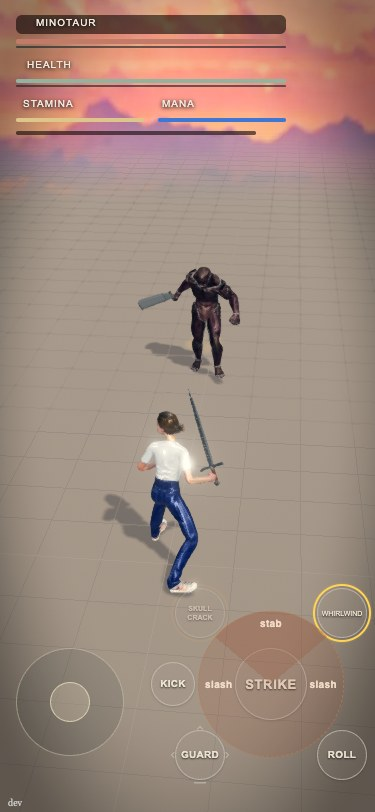
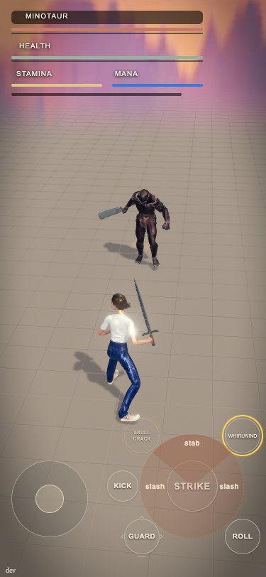
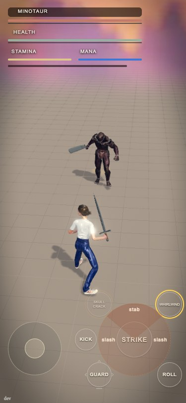
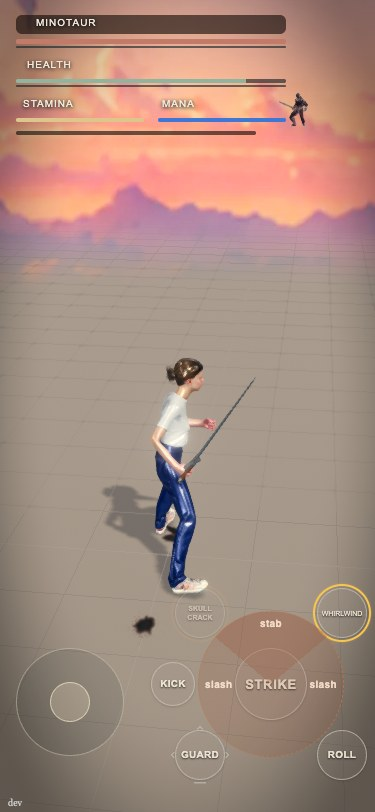
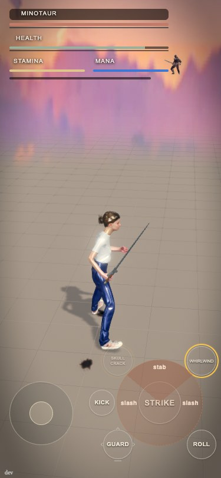
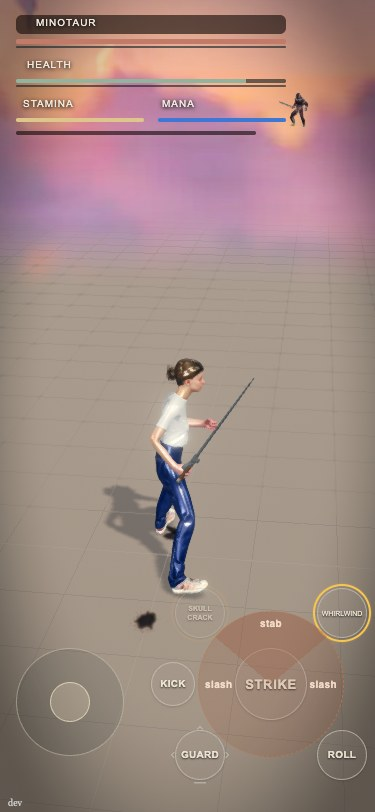
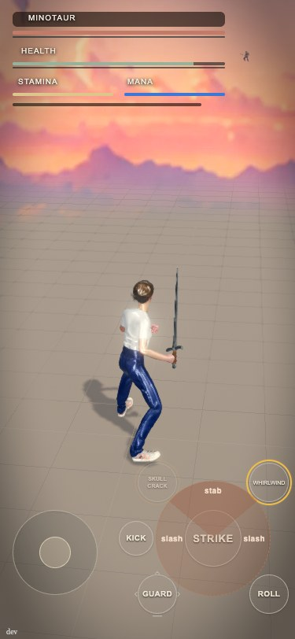
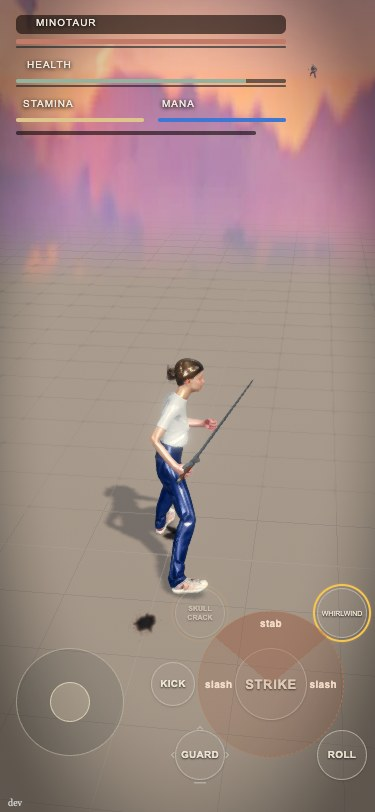

DRAFT, fast track. Dom approved the look: "fold the image so the lower part becomes the floor".

## What changes
The skyline strip's lower cloud band is laid flat on the ground under the sand. Past the melt (the sand turns transparent by angle, 14 to 9 degrees) the sand now dissolves into a cloud floor that runs to the horizon, so a far boss stands on cloud, not on nothing. The strip is untouched; the sand look near the hero is untouched.

- New file src/fight/skyfold.ts. A flat ring on the ground (x and z follow the camera, y is groundY), rows spaced the way a flat floor is seen (equal steps in 1/distance, so clouds shrink toward the horizon), the picture's x on the same bearing mapping as the strip's cylinder and the same yaw, so the clouds under the horizon line up with the sky above. The far 4 percent of the way in fades to nothing so it melts into the sky behind.
- Unlit, unfogged, not tone mapped, no shadows, no depth write, drawn after the strip and before the sand (SKYLINE_ORDER + orderOffset, between SKYLINE_ORDER and FLOOR_ORDER). It never touches the sand's material, so the floorDepthPush fix is intact.
- Every number is data/stage.json skyline.fold (validated in checkSkyline): on, query, v1, default, variants (file, bandTopFraction, bandBottomFraction), farMetres, nearMetres, featherFraction, groundY, orderOffset, around, rings.
- skyline.ts: two additive lines (a texture getter on the returned object). scene.ts: one build line, one update line, one import. The other branch's yawFollow row is not on main yet; the fold takes the strip's yawDegrees. If yawFollow lands first, the fold needs the same yaw: one line in skyfold.ts.
- Flags: ?skyfold=v1 builds nothing (today's look). ?skyfold=a is the strip's own lower band (no download). ?skyfold=b is the re-baked band (default). It is only built when the strip is on and the sand melts (?sky=v1 and ?skyview=v1 build nothing).

## A versus B (Dom asked for both)
- A: the strip's own lower band (rows 88 to 100 percent of the image, 99 rows) on the ground. Shares the already loaded texture: zero extra bytes.
- B: the same band re-baked by scripts/skyfold-bake.mjs into src/assets/skyline/skyfold-band.webp: 2048 x 256, softened (blur across a three-copy wrap so the ends meet), smoothly resampled, with faint wrap-safe grain. 10,878 bytes on disk; the file is fetched after the first frame, only for B.

Stills (375x812, docs/stills/sky-fold/): ready idle, mid-fight, and a far boss, each as v1 (before), a, b. The low lock camera is 3.7 m up; a boss 41 m behind the hero is about 48 m from the camera, a boss 110 m behind is a stress case.

- Ready idle: docs/stills/sky-fold/v1-ready-375.jpg, a-ready-375.jpg, b-ready-375.jpg
- Mid-fight: docs/stills/sky-fold/v1-mid-375.jpg, a-mid-375.jpg, b-mid-375.jpg
- Far boss 41 m: docs/stills/sky-fold/v1-far41-375.jpg, a-far41-375.jpg, b-far41-375.jpg
- Far boss 110 m: docs/stills/sky-fold/v1-far110-375.jpg, a-far110-375.jpg, b-far110-375.jpg

  

  

  

## Verdict: ship B (default in this PR)
- The fold works: before, the far boss sits on the sunset sky above the mountain ridge (floats); with the fold he stands in the cloud floor, in both A and B.
- A is clearly worse: a few rows of a picture pulled over the ground turn the ridge and cloud edges into tall vertical spikes (radial streaks), as Dom's mock-up warned. B, the same band softened, reads as a calm pink haze floor with the sand grid dissolving into it.
- B costs 10,878 bytes. Measured with scripts/weight-receipt.mjs at 375 on this build: ?skyfold=v1 5,421,073 B wire (39 files), default B 5,432,169 B (40 files), ?skyfold=a 5,421,073 B. Under the 5.5 MB budget, so data/build.json firstVisitBytes is NOT raised. (Live on 809c86e was 5,414,619 B; this branch is a few KB heavier for other reasons.)
- Honest cost: the fold lays cloud over the strip's own mountain ridge at a low camera, because the ground reaches the real horizon and the ridge sits 8.7 degrees below it. At the 3.7 m camera the ridge is covered by haze (compare v1 and b far41). With the high camera (about 34 m, boss near) nothing changes: that sand is solid. If Dom wants the ridge back, the follow-up is lowering the strip's dropMetres to 0 when the fold is on, so the ridge sits at the horizon where the fold ends. Not done here: it changes the backdrop Dom picked.

## Tests
test/skyfold.test.mjs: row validation, bad rows refused, ?skyfold=v1 and ?sky=v1 and no-melt build nothing and fetch nothing, band and UV maths (far edge at the horizon row, near edge at the bottom, 1/distance spacing, feather), mesh is flat and uses the cylinder's bearing mapping, order between strip and sand, no depth write, A downloads nothing, B size and the weight budget.

## Not verified
- Safari/WebKit and a real iPhone (stills are headless Chromium on a Mac, Metal).
- The 812x375 landscape and the free walk after a kill.
- The zone's open ground (longer far plane) with the fold.
- Full suite on Hugging Face: see the hfjob id in the PR comment.

🤖 Generated with [Claude Code](https://claude.com/claude-code)
